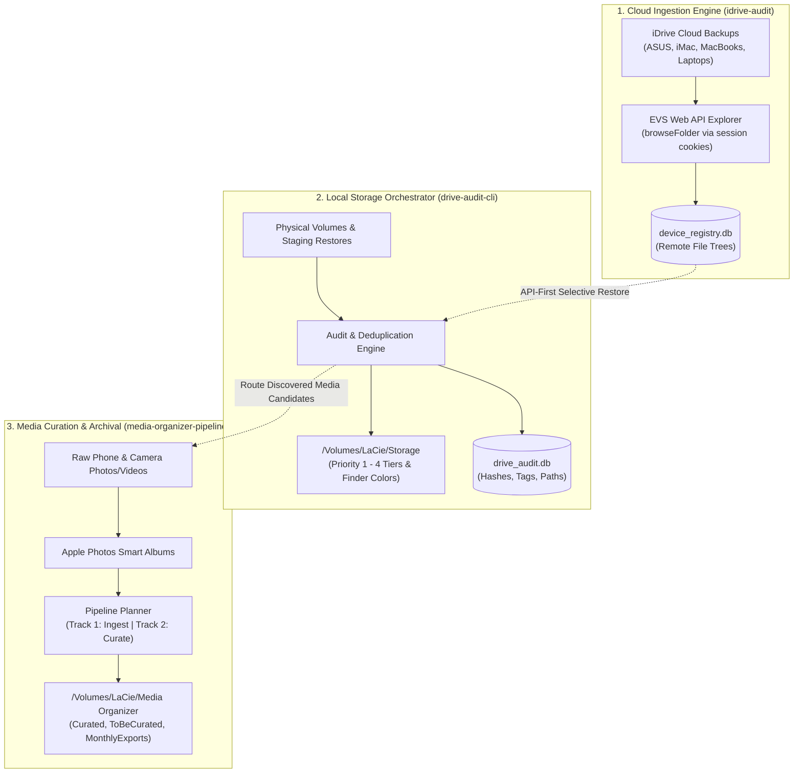

# Drive Audit & Storage Orchestrator (`drive-audit-cli`)

A fast, lightweight CLI orchestrator for auditing physical drives, indexing macOS Finder tags, extracting photo EXIF metadata, and governing file lifecycles into an organized SQLite database across local, external, and restored backup storage.

---

## 🏛️ The Storage Paradigm: "Semantics Before Movement"

Legacy backups and machine restores contain decades of personal history. Folder names like `~~Maxtor`, `Asus Final Data`, `RescueFileList`, or `Club George.doc` carry exceptional underlying stories and context that an algorithm cannot comprehend and must never be permitted to blindly delete or overwrite.

This repository enforces a core principle: **Semantics Before Movement (Human-Governed Storage)**.

### Core Governance Principles

1. **Human-in-the-Loop Approval Gate**:
   - No folder is permanently purged and no file is moved based solely on raw path heuristics or blind scripts.
   - The system analyzes, catalogs, and stages recommendations; final actions require explicit human inspection and approval.
2. **macOS Finder Tags as the Visual Living Ledger**:
   - File and folder classifications are visually synchronized directly to the desktop using native macOS Finder color tags.
   - 🔴 **Priority 1 (Red)**: Critical active personal data (current financial DBs, vital legal/family records).
   - 🔵 **Priority 2 (Blue)**: Systems, Developer environments, User profiles, Utilities & Bins.
   - 🟣 **Priority 3 (Purple)**: Historical / archival data, long-term documents, and foreign media.
   - 🟡 **Priority 4 (Yellow)**: Media Organizer Intake Depot (Photos & Home Videos awaiting curation).
   - ⚪ **Gray (Needs Review)**: Ambiguous legacy folders with underlying stories requiring human inspection before decisions are made.
   - 🟠 **Orange (Proposed Purge)**: Disposable application/OS caches (e.g. `imgCache`, `Thumbs.db`) staged for human sign-off.
3. **Preservation of Provenance & Context**:
   - When files are organized into `/Volumes/LaCie/Storage`, the database maintains complete ancestry: source device (`origin_device`), original directory hierarchy, and historical annotations.

---

## 🌐 The Three-Pillar Architecture

`drive-audit-cli` operates as one of three specialized pillars managing the complete storage and backup lifecycle:



1. **`idrive-audit` (Cloud Ingestion & Discovery)**:
   - Queries iDrive’s backend EVS APIs directly using authenticated web sessions to browse and catalog remote backup sets in the cloud without downloading multi-gigabyte OS debris.
2. **`drive-audit-cli` (Storage Orchestration & System Master)**:
   - Manages physical drives and `/Volumes/LaCie/Storage`, enforces the Priority 1–4 taxonomy, synchronizes macOS Finder color tags, detects duplicates with tier preference, and acts as the administrative control center.
3. **`media-organizer-pipeline` (Media Curation Engine)**:
   - Processes candidate photos and home videos through Apple Photos, Google Photos, AI curation, Moments, and long-term storage in `/Volumes/LaCie/Media Organizer`.

---

## 📊 Current Status of this Repository

### Active Milestones & Operational Status

- **Status**: **Operational / Active Ingestion Phase**
- **Canonical Storage Target**: `/Volumes/LaCie/Storage` (Priority 1–4 established with Finder color sync).
- **Current Intake Target**: `/Volumes/LaCie/iDrive-Cleanup/DeviceRestores/BENNY-ASUS-PC` (Windows device backup restore).

### Findings & Verification from Recent Audits:
- **Media Segregated**: **2,790 images (4.28 GB)** and **189 videos (495 MB)** isolated into `Images/` and `Videos/`. These serve as candidate assets destined for `media-organizer-pipeline` via `/Volumes/LaCie/Storage/Priority 4/Pictures/ASUS/`.
- **High-Value Documents Identified**:
  - **Quicken Financial DBs**: 22 `.qdf` and `.qdf-backup` databases (~78.6 MB in `Data/` and ~24.4 MB in `Documents/`).
  - **Tax & Legal PDFs**: 373 financial, tax return, and identity documents (~136 MB in `Downloads/`).
- **Proven Uniqueness (>98%)**:
  - Cross-referencing queries against `/Volumes/LaCie/Storage` revealed that **over 98% of these personal files were never previously migrated**.
  - Without this audit, these irreplaceable personal records would have been lost during an unverified backup purge.
- **Noise Isolated**:
  - Identified **806 Android Yahoo Mail `.0` and `.1` cache files** in `Documents/.../imgCache` staged for purging.
  - Identified **4.6 GB of obsolete 2011 Mac installer disk images** in `C/.../Bin/MAC` isolated from personal assets.

### Next Roadmap Steps:
1. **Human Tag Review**: Visually review staged Finder color tags (Red P1 for Quicken, Purple P3 for documents, Yellow P4 for media candidates).
2. **Promote to Storage**: Relocate verified unique files into `/Volumes/LaCie/Storage` with complete provenance tracking in SQLite.
3. **Empty Staging & Decommission**: Safely delete the local `BENNY-ASUS-PC` staging folder and decommission the device backup in the iDrive cloud.
4. **API-First Ingestion for Future Devices**: Transition to using `idrive-audit` to catalog remaining devices (`ASUS`, `NickolaysiMac`, etc.) directly via API before downloading anything to disk.

---

## Features

- **Host & Multi-Drive Tracking**: Automatically identifies machine hostnames, OS info, and IP addresses, enabling multi-machine drive inventorying in a unified database.
- **Native macOS Finder Tag Extraction**: Reads extended file attributes (`com.apple.metadata:_kMDItemUserTags`) via binary property list decoding to capture Finder color/text tags for both folders and files.
- **Manual Directory Tagging**: Search and tag specific directories interactively with custom labels.
- **Photo EXIF Metadata Parsing**: Automatically parses EXIF data from images (camera make/model, date taken, resolution, GPS coordinates, ISO, f-stop, exposure time).
- **File Categorization**: Automatically categorizes files into `image`, `video`, `audio`, `document`, `archive`, `code`, and `other`.
- **Search & Reporting**: Search files across direct tags and inherited folder tags, view storage breakdowns per host, and list all active tags.
- **Live Progress & Smart Caching**: Real-time terminal progress indicators and automatic skip-caching for folders scanned within a configurable window (default: 24h) if unchanged on disk.
- **Interruption Resilience**: Periodic batch commits and graceful `Ctrl+C` interrupt handling ensure zero data loss during long scans.
- **Relational SQLite Database**: Structured schema with WAL mode, foreign keys, and cascade rules for clean data integrity and easy custom querying.

---

## Requirements

- **Python 3.8+**
- **macOS** (for macOS Finder tag extraction; core auditing and EXIF parsing work cross-platform)
- Python packages:
  - `exifread`

---

## Installation

1. **Clone the repository**:
   ```bash
   git clone https://github.com/nickolaycohen/drive-audit-cli.git
   cd drive-audit-cli
   ```

2. **Create a virtual environment (optional, recommended)**:
   ```bash
   python3 -m venv venv
   source venv/bin/activate
   ```

3. **Install dependencies**:
   ```bash
   pip3 install -r python/requirements.txt
   # or
   python3 -m pip install -r python/requirements.txt
   ```

---

## Quick Start

Run the interactive CLI application:

```bash
./run.sh
# or
python3 python/drive_audit_finder.py
```

Upon launch, you will be presented with the main menu:

```text
=============================================
  DRIVE AUDIT & STORAGE ORCHESTRATOR  
=============================================
1. Tagging Review, Curation Wizard & Subfolder Triage
2. Scan & index directory (Read-only catalog & tag sync)
3. View hosts & storage overview
4. View top-level folder scans report
5. Generate report of largest files
6. Prune deleted records from DB (Sync with disk)
7. List all active tags (Directory & File)
8. Tag & sync folders (Priority Tiers, Finder Colors & DB)
9. Search files by tag (Finder & Manual)
10. Segregate non-media files from folder (On-demand migration)
11. Detect & clean duplicate files (Interactive duplicate resolver)
12. Exit
```

---

## 🧭 Interactive Prompt Trees & Submenus Reference

The orchestrator operates as an interactive, human-in-the-loop governance console. Below is the complete reference of all submenus, prompt shortcuts, and decision gates available within the CLI:

### 1. Option 1: Tagging Review & Management Menu
```text
Options:
  • 1-N        - Select folder number to inspect & edit tags / color / description / tier
  • 'v' / 'status' - Curation & Verification Report (Separated Approved vs Unapproved folders)
  • 'loc'      - Manage Priority Locations (Add / Edit / Remove mapped folders for Priority 1-4)
  • 'idrive'   - Audit iDrive backup inclusion (Check Priority 1 & 2 folders in iDrive)
  • 'w'        - Launch Sequential Curation Wizard (Triage subfolders across locations)
  • 'p1'-'p4'  - Edit description of a top-level Priority tier (Priority 1-4)
  • 'a'        - Auto-tag untagged folders with parent Priority & category
  • 'reset-tags' - Reset subfolder tags & verification (Preserve level-1, clear level-2+ tags)
  • 'r'        - Refresh view from filesystem
  • 'b'        - Return to main menu
```

### 2. Location Manager Menu (`loc` in Option 1)
```text
Actions:
  1. Add a new folder location mapping to a Priority level (Enter path, label, description)
  2. Toggle Active / Inactive status of a location (For unmounted or seasonal drives)
  3. Edit location Label or Description (Stored in SQLite priority_locations table)
  4. Remove / Unmap a location (Safely removes mapping without deleting files)
  5. Return to previous menu
```

### 3. Folder Inspection & Action Submenu (`1-N` in Option 1)
```text
Actions:
  1. Apply standard Priority tags (Priority tier with color + folder name tag)
  2. Add / Edit folder description (Stored in SQLite database)
  3. Custom tag & Finder color (Add/edit custom tag and pick color)
  4. Move / Reassign to a different Priority Tier (e.g., Priority 2 -> Priority 3)
  5. Propagate current tags to all subfolders in this subtree
  6. Remove / Clear all tags from this folder (Finder extended attributes & DB)
  7. Launch Curation Wizard on this folder's subdirectories (Scan & Triage)
  8. Add / Sync this folder to iDrive backup set (.plist)
  9. Return to folder list
```

### 4. Sequential Curation Wizard Decision Gate (`w` in Option 1)
```text
Prompts:
  [a] Approve & Verify
      ↳ Applies parent Priority Finder color tag + category tags
      ↳ Saves intelligent/approved description to SQLite
      ↳ Sets is_verified = 1 and verified_at timestamp
  [e] Edit Folder Name, Description or App
      ↳ Customize folder name, description or attached application before verifying
  [r] Rename Folder on Disk & DB
      ↳ Standalone folder renaming on filesystem and SQLite before triage
  [i] Inspect & Analyze Mystery / Extensionless Files (Conditional)
      ↳ Deep magic-byte header inspection for extensionless & cache files
      ↳ Identifies true formats (e.g. MS Money DBs, CAB archives, SQLite, PDFs)
      ↳ Provides interactive hex dump viewing ([v]) and safe extension restore ([r])
  [m] Move / Reassign Tier
      ↳ Relocate folder to another Priority tier, mapped location, or parent category
      ↳ Enter custom destination path directly (paste full path or select '[p]')
      ↳ Automatically creates missing destination directory hierarchy (e.g. Data/Legacy/Windows/MS-Money)
      ↳ Smart placement prompt: relocate & rename vs. relocate inside container
      ↳ Auto-detects Priority Tier from path, sets macOS Finder color tags & syncs SQLite records
  [s] Skip Folder
      ↳ Leaves folder unverified and untagged for later triage
  [q] Quit Wizard
      ↳ Safely exits with all verified progress persisted in SQLite
```

### 5. iDrive Backup Verification Wizard (`idrive` in Option 1)
```text
Options:
  1. Add missing Location Root(s) (Priority 1 & 2) to iDrive backup set (.plist)
  2. Select individual Category Folders to add to iDrive backup set (.plist)
  3. View current active items in iDrive backup sets (Main online & External sets)
  4. View step-by-step instructions for adding folders in iDrive Desktop GUI
  5. Return to Tagging Review menu
```

### 6. Reset Subfolder Tags & Verification Confirmation (`reset-tags` in Option 1)
```text
Confirmation Prompt:
  Proceed with resetting subfolder tags across all Priority locations? [y/N]:
  ↳ Preserves tags, colors, and descriptions on location roots & Level-1 folders
  ↳ Strips Finder color tags from Level-2+ subfolders
  ↳ Removes DB tags from Level-2+ subfolders in SQLite
  ↳ Resets is_verified = 0 on subfolders to re-enable fresh curation
```

### 7. Tag Manager Submenu (Option 8 from Main Menu)
```text
Tag Manager Options:
  1. Auto-tag storage directory tree by Priority & Category
     ↳ Scope 1: Recursive (All subfolders inherit Priority Tier & Category tags)
     ↳ Scope 2: Top 2 levels only (Priority tier folder & direct category folders)
  2. Manually tag a specific directory (Pick from 7 macOS Finder colors + custom label)
  3. Remove tags from a directory (Strips Finder extended attributes and DB tags)
  4. Re-sync Finder tags from disk into database (Bulk refresh)
  5. Return to main menu
```

### 8. Non-Media Migration Prompts (Option 10 from Main Menu)
```text
Prompts:
  • Enter directory to audit & clean: [/Volumes/LaCie/Storage/Priority 4/Pictures]
  • Enter non-media destination directory: [Default: <source>/NonMediaFiles]
  • Purge legacy thumbnail caches (Thumbs.db, .picasa.ini, *.pal, *.pmp)? [y/N]
  • Confirm moving non-media files to segregated folder? [y/N]
  • Prune empty folders left behind in media tree? [Y/n]
```

### 9. Duplicate File Cleanup Prompts (Option 11 from Main Menu)
```text
Scope Selection:
  1. Clean duplicates OUTSIDE primary Storage only (Recommended - protects repository)
  2. Full deduplication (Keep best copy in Storage, delete all redundant copies)

Review Mode:
  1. Batch Review (Preview summary table + single confirmation gate)
  2. Step-by-Step Interactive (Inspect and confirm each duplicate group individually)

Confirmation:
  • Confirm and execute deletion of duplicate files? [y/N]
  • Prune empty folders left behind? [Y/n]
```

---

## Detailed Menu Descriptions & Technical Architecture

### 1. Tagging Review, Curation Wizard & Subfolder Triage
Inspects mapped storage locations across Priority tiers (`Priority 1` through `Priority 4`) and provides an interactive overview and curation engine:
- **Intermediary Level — Priority Locations (`priority_locations`)**:
  - Rather than being restricted to a single `/Volumes/LaCie/Storage` tree, **each Priority level can have multiple mapped storage locations** (e.g., secondary external drives, local workstation SSDs, NAS volumes).
  - Manage mappings directly via option `'loc'`: add new folder paths to any Priority tier, toggle active/inactive status, assign descriptive labels (e.g. `'LaCie Primary Storage'`, `'Workstation Fast SSD'`), and edit location notes.
- **Structured Overview Table**: Displays level-1 folders grouped by parent Priority tier and mapped location, showing storage size, file counts, visual Finder color tags (🔴 Red P1, 🔵 Blue P2, 🟣 Purple P3, 🟡 Yellow P4), and folder descriptions (`↳ 📝 ...`).
- **Priority Tier Descriptions**: Each parent Priority tier displays its overarching storage mandate from SQLite.
- **Interactive Description Editing**:
  - Enter `'p1'` through `'p4'` to view or edit the top-level description of any Priority tier across its mapped locations.
  - Select any folder number (1-N) and choose **Action 2** to view or edit the folder description in the database.
- **Untagged Warnings**: Immediately highlights folders missing required Priority or category tags (`⚪ Untagged ⚠️`).
- **Sequential Curation Wizard ('w')**:
  - Steps through each mapped location and Level-1 category across Priority 1 $\rightarrow$ 4 sequentially.
  - Rapidly inspects Level-2 subfolders (e.g. `Priority 1/Data/13-Data.Money`, `Priority 1/Data/DB Backup`), profiling file counts, size, date spans, sample filenames, and file type distributions.
  - **File Type & Application Association Tree**: Maps discovered file extensions against the persistent SQLite `file_extensions` catalog (99+ formats across Financial, Tax, Code, DBs, Media, RAW Photos, etc.) and presents them as a structured application tree grouping files by their primary application, macOS alternatives, compatibility status, and mystery signatures:
    ```text
    • Discovered Files & Associated Apps:
      ├── [300 files] Windows Microsoft Money (Discontinued):
      │    • 141 .lrd (MS Money Lock/Report Def)  •  121 .mbf (MS Money Backup Archive)  •  32 .mny (MS Money Active DB)  •  (+2 more)
      │    ↳ Status: Archival Backup Only (Unusable on Mac/PC without legacy Windows VM)
      ├── [26 files] Financial / Banking Software (Mac: Banktivity / MoneyDance / Excel):
      │    • 26 .ofx (Open Financial Exchange Data)
      └── [4 files] Extensionless / Mystery Files:
           ↳ 🔍 4 (no ext) detected → 2x MS Money Backup (.mbf), 2x MS Money DB (.mny)
    ```
  - **Priority 1 High-Availability Mandate & Archival Relocation**:
    - **Rule**: **Priority 1** is strictly reserved for active personal data stored **ONLY on high-availability local storage** (Internal HD for iMini) with applicable, directly openable applications (e.g. active Quicken financial DBs, essential personal/legal documents), backed up to iDrive.
    - **Archival Policy**: Legacy and discontinued application archives (e.g. Windows Microsoft Money `.mny`, `.mbf`, `.lrd` or historical accounting data) belong primarily on external storage (**LaCie Priority 2** or secondary external drives), where they are safely preserved and **remain backed up to iDrive for eventual reference**.
    - **Relocation Suggestion**: When the wizard discovers discontinued/unusable files in Priority 1, it alerts with:
      `⚠️ Storage Policy Violation: Files cannot be opened directly! Priority 1 is reserved ONLY for high-availability internal storage (Internal HD for iMini) with active applications. Recommended: Move to external storage on LaCie ('Priority 2 / Data' or 'Priority 2 / Legacy / Windows Data', backed up to iDrive for reference)`.
    - **Auto-Bubbled Action**: Pre-selects and bubbles action `[m]` as `[Default]`, providing 1-click quick moves to `[1] Priority 2 ▸ Data on LaCie` or `[2] Priority 2 ▸ Legacy / Windows Data on LaCie` with automatic directory creation, Finder color tagging (Blue), and SQLite path synchronization while ensuring iDrive backup protection.
  - **Category Verification & Mismatch Warning**: Cross-references detected file types against the parent Priority Tier and Category folder (e.g., flags video files inside Priority 1 / Data or source code in Priority 4 / Media Depot with `⚠️ Category Mismatch: 100% Video in 'Priority 1 / Data'! Recommended: Priority 4 (Media Staging & Photos)`).
  - Generates intelligent, context-aware description suggestions.
    - `[a]` **Approve**: Applies parent Priority Finder color tag + category tags, persists description and required application (`app_needed`), and marks `is_verified = 1` in SQLite.
    - `[e]` **Edit**: Customize folder name, description and/or attached application before applying tags and marking verified.
    - `[r]` **Rename**: Standalone folder rename on disk and database before triage decisions.
    - `[i]` **Inspect Mystery Files**: Dynamically activated whenever extensionless or cache files (e.g. `spideroak_temp_*`) are detected. Reads binary magic headers (Jet/ISAM `.mny`, Cabinet `.mbf`, SQLite, PDF, Office XML, Media, executables), displays paths and sizes, provides interactive raw hex dump viewing (`[v]`), and allows safe batch extension restoration (`[r]`) synchronized with SQLite.
    - `[m]` **Move**: Relocate folder to another Priority tier, mapped location, or parent category (preserving required app metadata). Features 1-click archival relocation for Priority 1 rule violations.
    - `[s]` **Skip**: Leave untagged and unverified.
    - `[q]` **Quit**: Safely exits with all verified progress persisted.
- **Auto-Bubbling Menu Usage Tracking (`menu_option_usage`)**:
  - Automatically records every prompt and menu selection in SQLite (`menu_option_usage` table).
  - Dynamically floats the most frequently executed options to the top of the menu with a popularity indicator (`(Used 25x) 🔥`).
  - Sets the dynamic recommended default (`[Default: ...]`) to your #1 most frequent choice across Main Menu, Curation Wizard actions, Level-1 reviews, and Curation reports.
- **File Extensions Catalog ('ext')**:
  - View the complete seeded database catalog of file extensions, categories, descriptions, primary applications, and macOS alternatives.
- **Reset Subfolder Tags & Verification ('reset-tags')**:
  - Safely preserves tags, colors, and descriptions on all active Priority location roots and their Level-1 folders.
  - Strips Finder tags on disk and DB tags in SQLite from all subfolders beneath Level-1 (Level 2+).
  - Resets `is_verified = 0` on subfolders so they can be curated and verified one-by-one.
- **Interactive Folder Inspection & Editing**:
  - **Apply Standard Tags**: Instantly assigns the parent tier's Finder color and folder category tag.
  - **Folder Descriptions & Required App**: Add or edit custom folder notes and required software stored in SQLite.
  - **Custom Tags & Color Picker**: Assign custom tag names and choose any of the 7 macOS Finder colors.
  - **Move / Reassign Priority Tier**: Safely relocates a folder to a different Priority tier or location, updates its Finder color tag, and synchronizes all descendant paths in SQLite.
  - **Launch Folder Wizard**: Run the Curation Wizard directly scoped to that folder's direct children.
  - **Auto-Repair ('a')**: Scans all level-1 folders and batch-applies standard Priority tags to any untagged directories with a single confirmation.
- **iDrive Backup Verification ('idrive')**:
  - Directly inspects active macOS iDrive client backup sets (`backupReferenceFile.plist` and `NetworkDriveBackupSet.plist`).
  - Verifies whether folders dedicated as **Priority 1** (critical personal data) and **Priority 2** (systems, dev environments, user profiles, reference archives) are actively covered by iDrive.
  - Displays coverage status badges (`[☁️ iDrive: ✅]` vs `[☁️ iDrive: ❌ Missing]`).
  - Interactively stages missing Priority 1 and 2 paths (whole location roots or selected category subfolders) into iDrive's backup sets with automatic timestamped `.bak` copies, or provides step-by-step guidance for adding them in the iDrive Desktop application.

### 2. Scan & Index Directory (Read-only Catalog & Tag Sync)
Scans a target directory path (e.g., `/Users/username/Pictures` or `/Volumes/ExternalDrive`), indexing all files and subdirectories into SQLite. **Strictly read-only on the filesystem: never moves, alters, or deletes files on disk.**
- **Pre-Scan Finder Size Query**: Instantly queries macOS Finder via AppleScript for the target folder's total size before scanning starts.
- **Dynamic Live Progress & ETA**: Displays real-time progress percentage (`%`), estimated local completion time (`ETA: hh:mm:ss AM/PM`), current I/O speed (`MB/s`), and elapsed time.
- **Database Deletion Reconciliation**: Prunes missing database records when previously indexed files are deleted from disk.
- **Smart 24-Hour Skip Caching**: Skips scanning files in folders that were already scanned within the last $N$ hours and untouched since.
- **macOS Finder Tags & EXIF Parsing**: Captures native Finder color/name tags and image camera/GPS metadata.
- **Updates & Refreshes**: Automatically updates existing records if modified on disk.

### 3. View Hosts & Storage Overview
Displays a summary table showing all indexed hosts, their operating system, IP address, total file count, and aggregate storage size in gigabytes (GB).
- **Interactive Drive Performance Benchmark**: Prompt to measure real-world uncached read and write speeds (`MB/s`) across attached storage drives on demand.

### Storage Performance & I/O Benchmark (`benchmark_drives.py`)
Measures direct, uncached sequential read and write throughput (MB/s) for attached storage volumes on macOS using low-level direct I/O (`fcntl.F_NOCACHE = 48`) to completely bypass the operating system's RAM buffer cache:
- **Automatic Multi-Volume Discovery**: Automatically identifies local disks (Macintosh HD internal NVMe, SanDisk Extreme Pro NVMe SSD, LaCie Rugged HDD, etc.) and gracefully handles write-protected Time Machine backup snapshots.
- **Hardware Metadata Detection**: Detects bus interface (Apple Fabric PCIe vs USB 3.2), media type (NVMe SSD vs rotational HDD), filesystem, capacity, and remaining free space via `diskutil`.
- **Safety First**: Writes pseudo-random uncompressible test blocks to a temporary hidden file with `os.fsync`, measures raw throughput, and guarantees immediate deletion upon completion.
- **Command-line Options**:
  ```bash
  python3 python/benchmark_drives.py                  # Benchmark all mounted volumes (256 MB payload)
  python3 python/benchmark_drives.py --quick          # 64 MB payload quick test
  python3 python/benchmark_drives.py --target /Volumes/LaCie  # Test single drive
  python3 python/benchmark_drives.py --size-mb 512    # Custom payload size
  python3 python/benchmark_drives.py --json           # Machine-readable JSON output
  python3 python/benchmark_drives.py --interactive    # Interactive size selection menu
  ```

### 4. View Top-Level Folder Scans Report
Provides an overarching summary of each primary root folder scanned:
- Total subdirectories, total files, and cumulative storage per root scan.
- Detailed file category breakdown (image, video, document, archive, code, other).
- Top direct subfolders with individual subtree storage and file counts.
- Optional one-click export to **CSV** (`top_level_scans_report.csv`) or **Markdown** (`top_level_scans_report.md`).

### 5. Generate Report of Largest Files
Displays a formatted ranking of the largest indexed files across all scanned hosts:
- Configurable result limit (e.g. top 25, 50, 100).
- Optional category filter (`video`, `image`, `document`, `archive`, `code`, `other`).
- Displays formatted size, modified date, created date, hostname, and full path.
- Optional one-click export to **CSV** (`largest_files_report.csv`) or **Markdown** (`largest_files_report.md`).

### 6. Prune Deleted Files & Folders (Sync DB with Disk)
Instantly validates all indexed directories and files in the database against the local filesystem, immediately purging records for files and folders that no longer exist on disk.

### 7. List All Active Tags (Directory & File)
Lists all discovered tags grouped by:
- **Directory Tags**: Displays the tag name, source (`finder` vs `manual`), directory name, path, and host.
- **File Tags**: Displays direct Finder tags attached to specific files.

### 8. Tag & Sync Folders (Priority Tiers, Finder Colors & DB Submenu)
Provides a comprehensive tagging suite with two-way Finder $\leftrightarrow$ SQLite synchronization:
- **Auto-Tag Storage Tree by Priority & Category**: Recursively applies Priority tier tags with macOS Finder colors (🔴 Priority 1 = Red, 🔵 Priority 2 = Blue, 🟣 Priority 3 = Purple, 🟡 Priority 4 = Yellow) and Category tags across storage directory trees.
- **Manual Folder Tagging**: Attach custom tags and pick Finder colors (Gray, Green, Purple, Blue, Yellow, Red, Orange) with immediate disk and DB sync.
- **Remove / Clear Folder Tags**: Strip Finder extended attributes and DB tags cleanly.
- **Re-Sync Finder Tags from Disk to DB**: Re-reads all Finder tags from filesystem attributes to refresh database records.

### 9. Search Files by Tag (Finder & Manual)
Search for files matching a specific tag query. Matches both:
- Tags placed directly on the file.
- Tags inherited from the parent directory.
- Displays file category, file size in MB, full path, and camera model (if EXIF exists).

### 10. Segregate Non-Media Files from Folder (On-demand Migration)
Audits a source photo/video library folder and cleans it by:
- Preserving all photos and videos in the source directory.
- Relocating non-media files (documents, executables, archives, design `.psd` files, scripts) to a destination folder (e.g., `NonMediaFiles`), mirroring the relative folder hierarchy.
- Optionally purging legacy Windows and Picasa thumbnail caches (`Thumbs.db`, `.picasa.ini`, `*.pal`, `*.pmp`, `.tmp`).
- Pruning empty directories left in the source media directory.
- Offering immediate database sync/reconciliation.

### 11. Detect & Clean Duplicate Files (Interactive Duplicate Resolver)
Scans indexed files across all folders to find exact duplicates (`name` and byte size match):
- **Storage Location Keeper Rule**: Identifies copies inside your designated primary Storage repository (e.g., `/Volumes/LaCie/Storage`) and guarantees that **1 copy in Storage is preserved as the keeper (`[KEEP]`)**, giving priority to higher Priority tiers (`Priority 1` > `Priority 2` > `Priority 3` > `Priority 4`).
- **Flexible Cleanup Scope**:
  - *Scope 1 (Outside Storage Only)*: Deletes only duplicate copies residing in staging, backup restore, or scratch folders (e.g., `/Volumes/LaCie/iDrive-Cleanup/...`), keeping all Storage repository copies untouched.
  - *Scope 2 (Full Deduplication)*: Keeps exactly 1 best copy in Storage and deletes all redundant copies (both external and internal).
- **Physical Disk Safety Verification**: Double-checks disk existence and exact byte sizes of the keeper file before unlinking any duplicate.
- **Interactive Review Modes**: Choose between *Batch Review* (preview table + one-click confirmation) or *Step-by-Step* (inspect and confirm group by group).
- **Automated Database Sync**: Instantly removes deleted file IDs from SQLite and offers to prune empty directories.

### 12. View Curation & Verification Report (Approved vs Unapproved Folders)
Provides an executive audit report separating approved/verified folders and files (`is_verified = 1`) from pending unapproved folders and files (`is_verified = 0`):
- **Executive Progress Bar & Statistics**: Visual progress meter showing overall folder approval percentage, along with total files and cumulative storage sizes for both verified and unverified data.
- **Priority Tier & Location Breakdown**: Shows approval ratios and storage consumption broken down by mapped location (`Priority 1` through `Priority 4`).
- **Approved Folders Inventory**: Full listing of verified folders showing file counts, storage size, approval date (`verified_at`), and saved descriptions.
- **Pending Curation Listing**: Curated listing of Level-1 and Level-2 unapproved category folders awaiting triage in the Curation Wizard (`w`).
- **Granular Tier Filtering**: Filter approved vs unapproved inventories specifically for Priority 1, 2, 3, or 4.
- **One-Click Export**: Export full audit reports to Markdown (`curation_status_report.md`) or CSV (`curation_status_report.csv`).
- **Direct Access**: Also accessible anytime inside Option 1 by typing `'v'` or `'status'`.

---

## Database Architecture & Persistent Storage

All audit data is saved to a persistent SQLite database (`drive_audit.db`). To decouple persistent state from version-controlled source code, the operational database resides outside the Git repository:

- **Primary Canonical Storage**: `/Volumes/Extreme Pro/Data/sqlite/drive-audit/drive_audit.db`
- **Dynamic CLI Discovery**: The orchestrator automatically connects to the Extreme Pro database when mounted (with fallback to `db/drive_audit.db` symlink or `DRIVE_AUDIT_DB` environment variable).
- **Offsite Cloud Backup**: `/Volumes/Extreme Pro/Data/sqlite` is actively registered in macOS iDrive client (`NetworkDriveBackupSet.plist`) for scheduled cloud disaster recovery.
- **Local Snapshots**: Periodic point-in-time SQLite backups can be staged into `/Volumes/LaCie/Storage/Priority 1/Data/DB Backup`.

### Relational Schema

```
  ┌────────────┐
  │   hosts    │
  └─────┬──────┘
        │ 1:N
        ▼
  ┌────────────┐        1:N       ┌────────────────┐
  │directories ├─────────────────►│ directory_tags │
  └─────┬──────┘                  └────────────────┘
        │ 1:N
        ▼
  ┌────────────┐        1:N       ┌────────────────┐
  │   files    ├─────────────────►│   file_tags    │
  └─────┬──────┘                  └────────────────┘
        │ 1:1
        ▼
  ┌────────────────┐
  │ media_metadata │
  └────────────────┘
```

- **`hosts`**: `id`, `hostname`, `os_name`, `ip_address`, `first_scanned_at`, `last_scanned_at`
- **`priority_locations`**: `id`, `priority_tier`, `path`, `label`, `description`, `is_active`, `created_at`
- **`directories`**: `id`, `host_id`, `path`, `name`, `created_at`, `modified_at`, `scanned_at`, `description`, `is_verified`, `verified_at`
- **`directory_tags`**: `id`, `directory_id`, `tag_name`, `source` (`finder` | `manual`), `created_at`
- **`files`**: `id`, `directory_id`, `name`, `category`, `extension`, `size_bytes`, `created_at`, `modified_at`, `scanned_at`
- **`file_tags`**: `id`, `file_id`, `tag_name`, `created_at`
- **`media_metadata`**: `id`, `file_id`, `camera_make`, `camera_model`, `date_taken`, `width`, `height`, `gps_latitude`, `gps_longitude`, `f_number`, `exposure_time`, `iso`

---

## Custom SQL Queries

Because data is stored in standard SQLite format (`drive_audit.db`), you can run queries with any SQLite client:

```sql
-- Find top 10 largest video files
SELECT f.name, (f.size_bytes / 1024.0 / 1024.0) AS size_mb, d.path
FROM files f
JOIN directories d ON f.directory_id = d.id
WHERE f.category = 'video'
ORDER BY f.size_bytes DESC
LIMIT 10;

-- Find all photos taken with a specific camera model
SELECT f.name, m.camera_model, m.date_taken, d.path
FROM files f
JOIN media_metadata m ON f.id = m.file_id
JOIN directories d ON f.directory_id = d.id
WHERE m.camera_model LIKE '%Sony%' OR m.camera_model LIKE '%Canon%';
```

---

## License

MIT License.
